# LaserArmor

LaserArmor is a benchmark for detecting laser attacks and restoring corrupted images.
It contains three detectors and twelve restoration pipelines:

- Detection: LaserGuard [[1]](#references), BlindedByBeam [[2]](#references), and **StripeDet (Ours)**.
- Restoration: ADOM [[3]](#references), Restormer [[4]](#references), Uformer [[5]](#references), NAFNet [[6]](#references), AnyIR [[7]](#references), TSFormer [[8]](#references)(**_Best Baseline_**), ShiftLUT [[9]](#references), MPMF-Net [[10]](#references), DCMGFormer [[11]](#references), JarvisIR [[12]](#references), GenDeg [[13]](#references), and **StripeRes (Ours)**.


## Physical evaluation videos

### Indoor Evaluation

#### Red laser attack

##### Object detection (YOLOv8)

<table>
  <tr>
    <th width="33%">Attacked</th>
    <th width="33%">LaserArmor</th>
    <th width="33%">TSFormer</th>
  </tr>
  <tr>
    <td>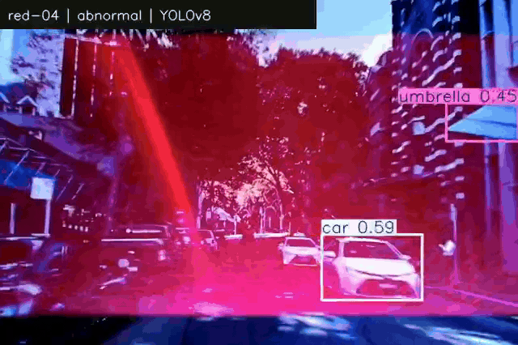</td>
    <td>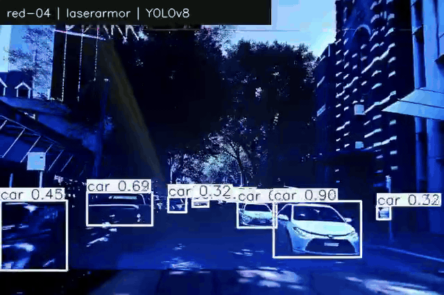</td>
    <td>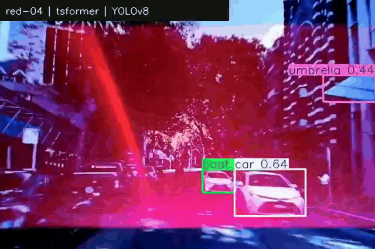</td>
  </tr>
</table>

##### Semantic segmentation (DeepLabV3+)

<table>
  <tr>
    <th width="33%">Attacked</th>
    <th width="33%">LaserArmor</th>
    <th width="33%">TSFormer</th>
  </tr>
  <tr>
    <td>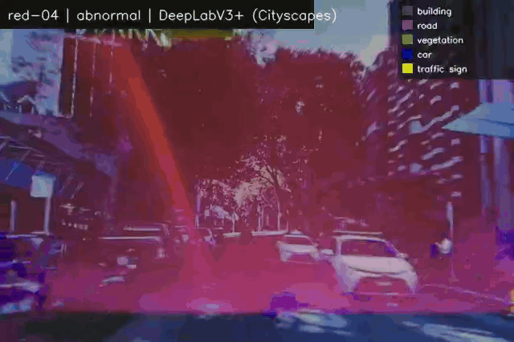</td>
    <td>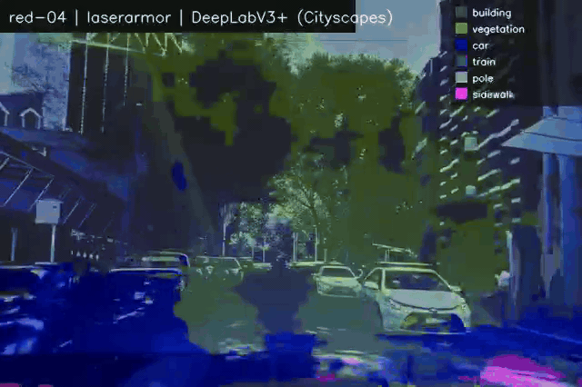</td>
    <td>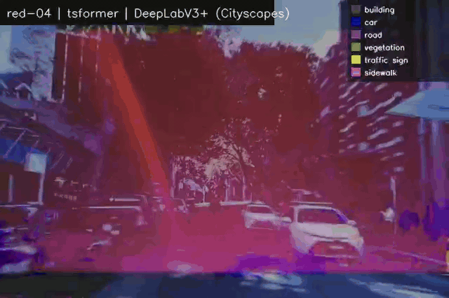</td>
  </tr>
</table>

#### Green laser attack

##### Object detection (YOLOv8)

<table>
  <tr>
    <th width="33%">Attacked</th>
    <th width="33%">LaserArmor</th>
    <th width="33%">TSFormer</th>
  </tr>
  <tr>
    <td>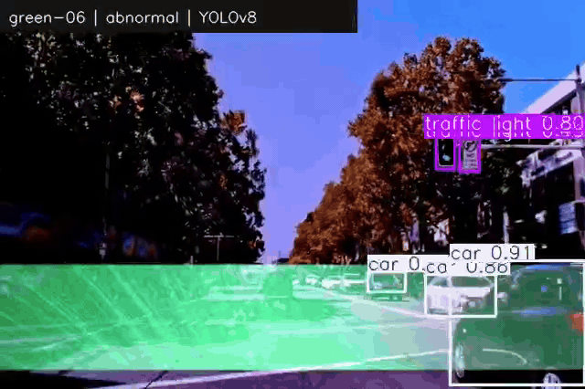</td>
    <td>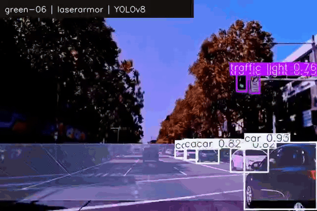</td>
    <td>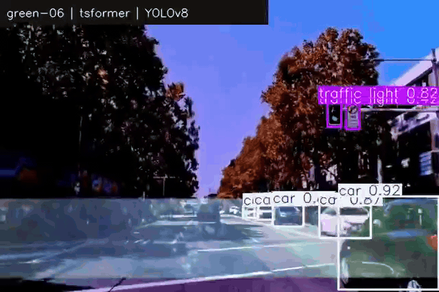</td>
  </tr>
</table>

##### Semantic segmentation (DeepLabV3+)

<table>
  <tr>
    <th width="33%">Attacked</th>
    <th width="33%">LaserArmor</th>
    <th width="33%">TSFormer</th>
  </tr>
  <tr>
    <td>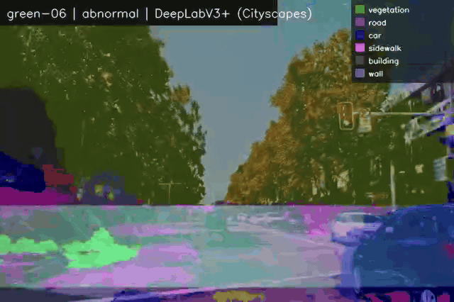</td>
    <td>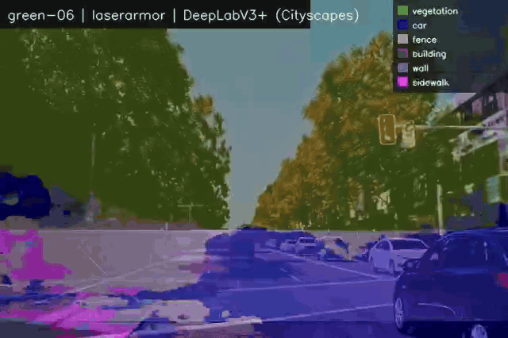</td>
    <td>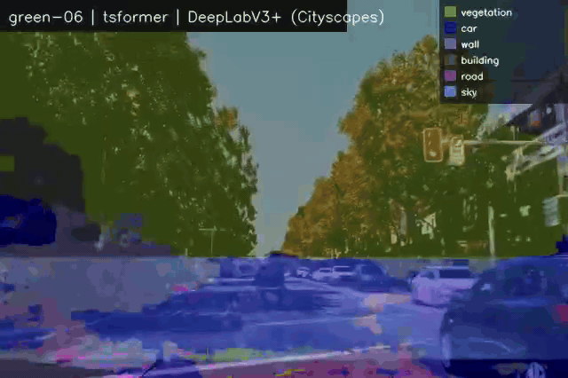</td>
  </tr>
</table>

### Outdoor Evaluation

#### Red laser attack

##### Object detection (YOLOv8)

<table>
  <tr>
    <th width="33%">Attacked</th>
    <th width="33%">LaserArmor</th>
    <th width="33%">TSFormer</th>
  </tr>
  <tr>
    <td>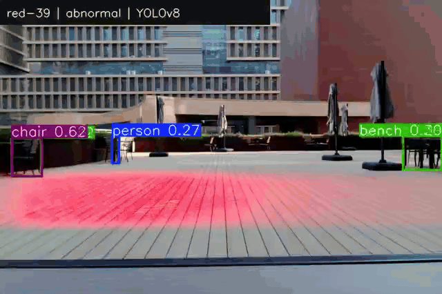</td>
    <td>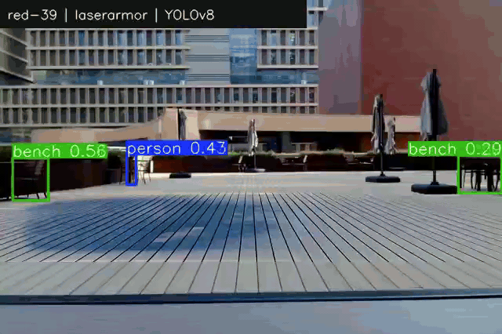</td>
    <td>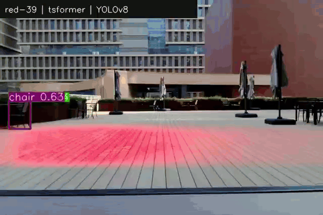</td>
  </tr>
</table>

##### Semantic segmentation (DeepLabV3+)

<table>
  <tr>
    <th width="33%">Attacked</th>
    <th width="33%">LaserArmor</th>
    <th width="33%">TSFormer</th>
  </tr>
  <tr>
    <td>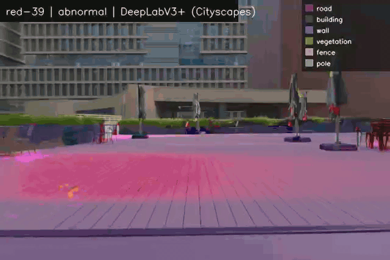</td>
    <td>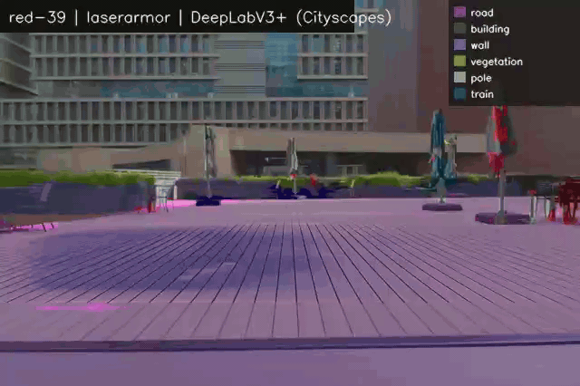</td>
    <td>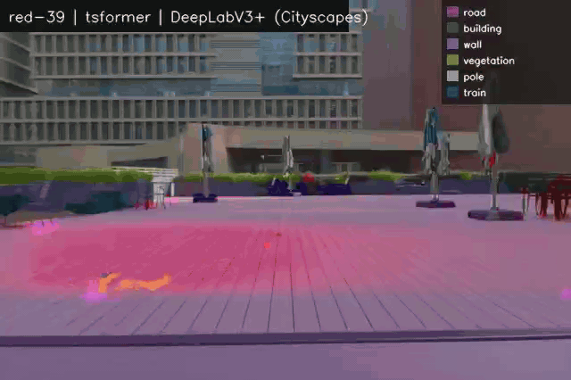</td>
  </tr>
</table>

#### Green laser attack

##### Object detection (YOLOv8)

<table>
  <tr>
    <th width="33%">Attacked</th>
    <th width="33%">LaserArmor</th>
    <th width="33%">TSFormer</th>
  </tr>
  <tr>
    <td>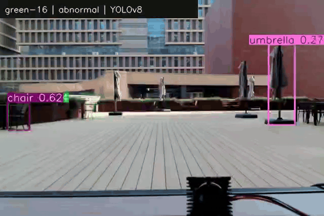</td>
    <td>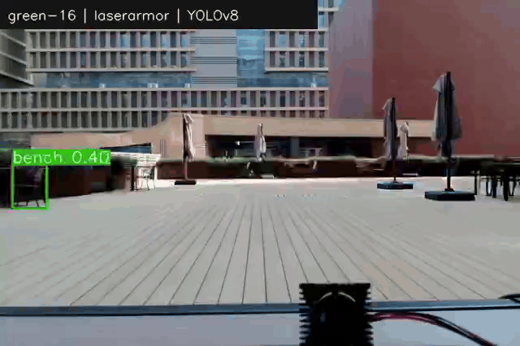</td>
    <td>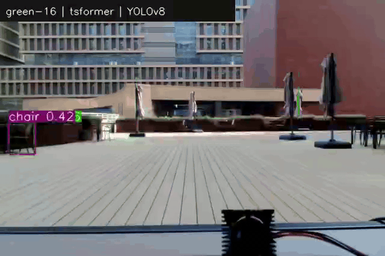</td>
  </tr>
</table>

##### Semantic segmentation (DeepLabV3+)

<table>
  <tr>
    <th width="33%">Attacked</th>
    <th width="33%">LaserArmor</th>
    <th width="33%">TSFormer</th>
  </tr>
  <tr>
    <td>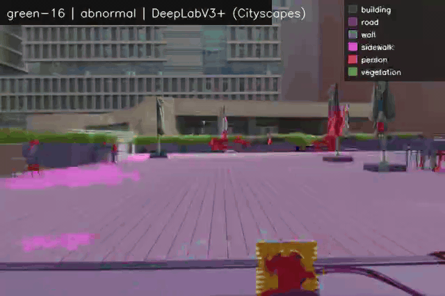</td>
    <td>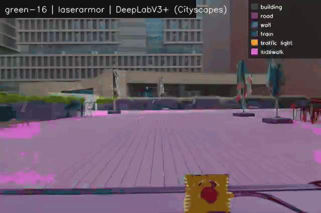</td>
    <td>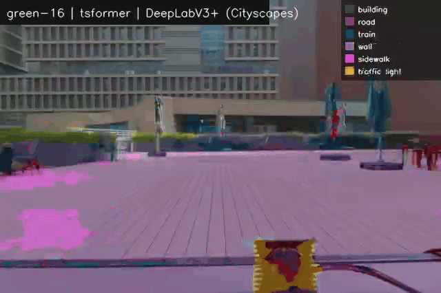</td>
  </tr>
</table>

- Other physical evaluation videos are available in the **[video archive](https://osf.io/khqrs/overview?view_only=4639dd563cb24446ae410c1d88c7d6e4)**.

## 1. Installation

Python 3.10 or newer and a CUDA-enabled PyTorch installation are recommended.
Create an isolated environment, install a PyTorch build appropriate for the local CUDA version, and then install this project:

```bash
pip install -e .
```

The default configuration uses CUDA when it is available and otherwise uses CPU.
Some large restoration models can be impractical on CPU.

Run the weight-free smoke test after installation:

```bash
python scripts/smoke_test.py
```


## 2. Model weights files

Download all required files from the **[weight archive](https://osf.io/khqrs/overview?view_only=4639dd563cb24446ae410c1d88c7d6e4)**.

The required local layout is:

```text
weights/
  detection/
    BlindedByBeam/
      bdd100k.joblib
      kitti.joblib
      nuscenes.joblib
      udacity.joblib
      waymo.joblib
    StripeDet/
      bdd100k.pth
      kitti.pth
      nuscenes.pth
      udacity.pth
      waymo.pth
  restoration/
    AnyIR.pth
    DCMGFormer.pth
    GenDeg.pth
    JarvisIR.pth
    MPMF-Net.pth
    NAFNet.pth
    Restormer.pth
    StripeRes-ResidualRemove.pth
    TSFormer.pth
    Uformer.pth
    ShiftLUT/
      config.json
      DW0_LSB.json
      DW0_LSB.npz
      DW0_MSB.json
      DW0_MSB.npz
      DW1_MSB.json
      DW1_MSB.npz
      offset.npy
      PW0_MSB.json
      PW0_MSB.npz
      PW1_MSB.json
      PW1_MSB.npz
      source_opt.json
      UP_MSB.json
      UP_MSB.npz
```

## 3. Evaluation data preparation

Download clean camera images directly from the official dataset providers. Dataset files are not distributed through the project links.

| Dataset | Official source | Suggested clean-image content |
|---|---|---|
| BDD100K | [BDD100K download portal](https://bdd-data.berkeley.edu/) | Validation or test camera images |
| KITTI | [KITTI raw data](https://www.cvlibs.net/datasets/kitti/raw_data.php) | Raw road-scene camera images |
| nuScenes | [nuScenes download portal](https://www.nuscenes.org/nuscenes) | Extracted front-camera images |
| Udacity | [Udacity self-driving car datasets](https://github.com/udacity/self-driving-car/tree/master/datasets) | Camera images from a selected driving dataset |
| Waymo Open Dataset | [Waymo Open Dataset downloads](https://waymo.com/open/download/) | Extracted front-camera images |

Each input path may contain nested folders. Run the single preparation script from the repository root and provide one `NAME=PATH` argument per clean dataset:

```bash
python scripts/prepare_evaluation_data.py --dataset bdd100k=/path/to/bdd100k/images --dataset kitti=/path/to/kitti/images --dataset nuscenes=/path/to/nuscenes/images --dataset udacity=/path/to/udacity/images --dataset waymo=/path/to/waymo/images --output-root data/prepared --colors red green --styles single multi --resize-long-side 640
```

For every source image, the script produces a clean image, an attacked image, a binary attack mask, a StripeRes-DominantRemove coarse result, and a manifest record. It creates four variants for each dataset:

```text
data/prepared/<dataset>/
  green-multi/
  green-single/
  red-multi/
  red-single/
```

Every variant contains `clean/`, `attacked/`, `mask/`, `coarse/`, and `manifest.jsonl`. Attack generation is deterministic for a fixed `--seed`. Use `--max-images` for a small smoke-test subset. Once this step and the weight extraction step are complete, evaluation can start immediately; no model training or detector fitting is needed.

For a source-disjoint training/test protocol, prepare a `frames.csv` with
`dataset,image_path,source_sequence_id` and a `templates.csv` with
`template_path,source_template_id`. The IDs must come from the original dataset
and physical capture records; do not infer them from neighboring file names.
Run:

```bash
python scripts/split_by_source.py --frames-csv frames.csv --templates-csv templates.csv --output-dir data/source_split --expected-total 35721 --train-frames 3572
```

The command writes frame and template split manifests and fails if the requested
frame count cannot be reached without dividing a source sequence. All crops and
color transformations must inherit the split of their source template during
subsequent synthesis. The preparation script above generates procedural stripes
and does not consume these manifests; its output alone does not reproduce the
paper's physical-template training/test protocol.

## 4. One-command full evaluation

First verify that all configured datasets and assets are present:

```bash
python scripts/evaluate_all.py --config configs/full_pipeline.json --dry-run
```

Then run every configured detector-restorer combination on every prepared dataset and attack variant:

```bash
python scripts/evaluate_all.py --config configs/full_pipeline.json --output-root results
```

The default matrix contains 3 detectors, 12 restoration pipelines, 5 datasets, and 4 attack variants. Results are written to `results/` and include restored images, predicted detector masks, per-image CSV files, per-run JSON summaries, `all_metrics.csv`, and `all_metrics.json`.

Detection metrics include accuracy, precision, recall, F1, AUROC, mask IoU, mask Dice, and latency. Restoration metrics include attacked-image PSNR, restored-image PSNR, SSIM, masked PSNR, masked MAE, and latency.

To run one pipeline only, use:

```bash
python full_pipeline.py --config configs/full_pipeline.json --dataset-name bdd100k --dataset-dir data/prepared/bdd100k/red-single --detector StripeDet --restorer StripeRes --output-dir results/bdd100k/red-single/StripeDet/StripeRes
```

## Repository layout

```text
configs/full_pipeline.json
laserarmor/detection/
laserarmor/restoration/
scripts/prepare_evaluation_data.py
scripts/evaluate_all.py
full_pipeline.py
```

## References

1. [*Laser Guard: Efficiently Detecting Laser-Based Physical Adversarial Attacks in Autonomous Driving*](https://doi.org/10.1109/ACCESS.2025.3540653)
2. [*Blinded by the Beam: A Unified Real-Time Defense Against Laser-Based Attacks on Navigational Perception of Autonomous Vehicles*](https://doi.org/10.1109/ACCESS.2026.3681208)
3. [*Fourier Domain Anomaly Detection and Spectral Fusion for Stripe Noise Removal of TIR Imagery*](https://doi.org/10.3390/rs12223714)
4. [*Restormer: Efficient Transformer for High-Resolution Image Restoration*](https://openaccess.thecvf.com/content/CVPR2022/html/Zamir_Restormer_Efficient_Transformer_for_High-Resolution_Image_Restoration_CVPR_2022_paper.html)
5. [*Uformer: A General U-Shaped Transformer for Image Restoration*](https://openaccess.thecvf.com/content/CVPR2022/html/Wang_Uformer_A_General_U-Shaped_Transformer_for_Image_Restoration_CVPR_2022_paper.html)
6. [*Simple Baselines for Image Restoration*](https://arxiv.org/abs/2204.04676)
7. [*Any Image Restoration via Efficient Spatial-Frequency Degradation Adaptation*](https://arxiv.org/abs/2504.14249)
8. [*TSFormer: A Robust Framework for Efficient UHD Image Restoration*](https://arxiv.org/abs/2411.10951)
9. [*ShiftLUT: Spatial Shift Enhanced Look-Up Tables for Efficient Image Restoration*](https://arxiv.org/abs/2603.00906)
10. [*Multi-axis Prompt and Multi-dimension Fusion Network for All-in-one Weather-degraded Image Restoration*](https://ojs.aaai.org/index.php/AAAI/article/view/32898)
11. [*Dual-attention Cooperative and Multi-view Gated Transformer for Adverse Weather Removal*](https://doi.org/10.1016/j.patcog.2026.113633)
12. [*JarvisIR: Elevating Autonomous Driving Perception with Intelligent Image Restoration*](https://openaccess.thecvf.com/content/CVPR2025/html/Lin_JarvisIR_Elevating_Autonomous_Driving_Perception_with_Intelligent_Image_Restoration_CVPR_2025_paper.html)
13. [*GenDeg: Diffusion-based Degradation Synthesis for Generalizable All-In-One Image Restoration*](https://openaccess.thecvf.com/content/CVPR2025/html/Rajagopalan_GenDeg_Diffusion-based_Degradation_Synthesis_for_Generalizable_All-In-One_Image_Restoration_CVPR_2025_paper.html)
